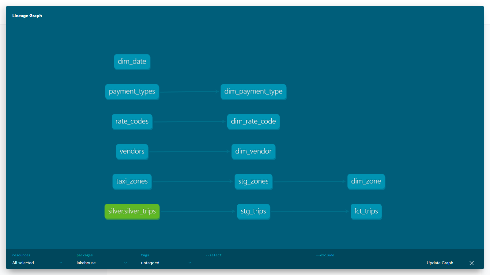

# lakehouse-pipeline

Batch data platform over NYC TLC yellow taxi trip records, with bronze, silver and gold layers, data quality checks and a dashboard.

## Decisions

Dataset: NYC TLC trip records, yellow taxi, monthly parquet files.
Compute: Databricks Free Edition (PySpark, Delta).
Storage: Databricks Unity Catalog volumes.
Orchestration: Apache Airflow in Docker, run in WSL2 or on the homelab.

PySpark and pyarrow do not install on native ARM64 Windows, so run Python inside WSL2.

## Status

| Milestone | State |
|-----------|-------|
| M1 Ingestion (bronze) | done |
| M2 Transformation (silver) | done |
| M3 Modelling (gold, dbt) | done |
| M4 Data quality | done |
| M5 Serving and BI | not started |
| M6 Tie-in with the text-to-SQL agent | not started |

## M1: bronze ingestion

```
TLC CloudFront  ->  HttpDownloader  ->  load_month  ->  Storage (volume or local)
                                            |
                                            +-> manifest JSON (rows, sha256, size)
```

`load_month` downloads one month, records its row count and SHA-256, uploads the file to
`tlc/<dataset>/year=YYYY/month=MM/`, and writes a manifest to `_manifests/` last.
A month counts as loaded only when both the data file and the manifest exist, so a crash between
the two steps is redone on the next run. The data path depends only on dataset and month, so a
redo overwrites the file and never duplicates it.

The Airflow DAG `tlc_pipeline` runs once per month with `catchup=True` and one active run at a
time. The TLC publishes about two months late. A run for an unpublished month retries every six
hours, five times, then fails. Clear the failed run in Airflow once the file is published.

### Run it

```
make install
make test
make backfill START=2024-01 END=2024-12 DATA_DIR=$HOME/lakehouse-data
```

Airflow, with a `docker/.env` that sets `DATABRICKS_HOST` and `DATABRICKS_TOKEN`:

```
make airflow-up
```

Then open http://localhost:8080 (user and password `admin`) and unpause `tlc_pipeline`.

## M2: silver

```
bronze parquet -> standardise -> flag_rejects -> split -> deduplicate -> labels and zones -> Delta
                                                    |
                                                    +-> silver_trips_rejected (with reject_reason)
```

`lakehouse.silver.job` reads one bronze month at a time on Databricks serverless, through
Databricks Connect. It renames columns to snake_case, casts every column to one type, labels each
bad row with the first quality rule it breaks, removes duplicates on a natural key, and joins the
taxi zone lookup. Good rows go to `workspace.lakehouse.silver_trips`, partitioned by pickup date.
Rejected rows keep their reason in `silver_trips_rejected`, ready for the M4 quarantine. Each
month is written with `replaceWhere`, so a rerun replaces that month and never duplicates it.
Row counts per month land in `silver_run_log`.

The quality rules, column types and lookup labels live in `lakehouse/silver/rules.py` as plain
data. Results, including the layout benchmark, are in RESULTS.md.

```
pip install -e ".[spark]"        # Databricks Connect, not plain pyspark
python -m lakehouse.ingest --start 2024-01 --end 2024-12 --storage databricks     --root /Volumes/workspace/lakehouse/bronze
python -m lakehouse.silver.job --start 2024-01 --end 2024-12
python scripts/benchmark_layout.py --build
```

The Spark tests need `DATABRICKS_HOST` and `DATABRICKS_TOKEN` and skip without them.

## M3: gold, dbt

A dbt project in `dbt/` builds a star schema in `workspace.gold` on the Databricks serverless SQL
warehouse, using `dbt-databricks`.

```
silver_trips -> stg_trips -> fct_trips          (incremental, merge on trip_key)
taxi_zones   -> stg_zones -> dim_zone
payment_types, rate_codes, vendors (seeds) -> dim_payment_type, dim_rate_code, dim_vendor
dim_date                                       (generated calendar)
```



`fct_trips` has one row per trip, with foreign keys to the five dimensions and the trip measures.
The silver data has no trip id, so `trip_key` is a hash of the fields the silver job deduplicates
on. The fact table loads incrementally with a merge on that key and reloads the last 31 days on
each run, because the silver job replaces whole months. To merge an older month that silver rebuilt, pass
`--vars '{reload_from: "2024-03-01"}'`. The merge never deletes, so after a rule change that
removes trips from silver, run `dbt build --full-refresh -s fct_trips`. The date dimension covers
2024 to 2026 and its range is set by `calendar_start` and `calendar_end` in `dbt_project.yml`.
The model uses liquid clustering on pickup
date and pickup zone. Trips with no rate code map to the dictionary's Unknown code.

The lineage graph shows data flow only. The links from the fact table to each dimension are
checked by `relationships` tests in `dbt/models/marts/marts.yml`.

```
pip install "dbt-databricks>=1.9,<2"      # use a separate virtual environment
cd dbt
dbt build --profiles-dir .                # seeds, models and tests
dbt docs generate --profiles-dir . && dbt docs serve --profiles-dir .
```

dbt reads `DATABRICKS_HOST`, `DATABRICKS_TOKEN` and `DATABRICKS_HTTP_PATH` from the environment.

## M4: data quality

Quality is checked at three points.

Row level, in the silver job: each bad row gets a `reject_reason` and goes to
`silver_trips_rejected`. This is the row quarantine, and it keeps every rejected row with its reason.

Batch level, before silver is published: a Great Expectations gate checks one month at a time.
It checks that timestamps are present, pickups fall inside the month, distance, fare and zone ids
stay in range, payment types are known codes, the row count is near the recent median of months
that passed, and the data reaches within three days of both ends of the month. Each value check
allows a small share of bad rows, because the source always has some, and fails only when too many
are bad. The limits are plain data in `lakehouse/quality/thresholds.py`.

A batch that fails is not published. Its rows are held in `quarantine_trips` with the failed
checks, the verdict is recorded in `quality_runs`, and the Airflow task fails without retries. The
task log carries the alert text and an `on_failure_callback` logs a second alert line. A later
batch that passes clears that month from quarantine.

Model level, in dbt: `unique`, `not_null`, `relationships` and `accepted_values` tests, plus two
singular tests that no trip has a non-positive amount or a dropoff before its pickup.

The Airflow DAG is `tlc_pipeline`. It loads a month into bronze, then builds silver through the
gate. Airflow names a run by the start of its data interval, so the run for April has a logical
date of April 1 and starts on May 1.

### Planted bad batch

`scripts/demo_bad_batch.py` builds a sandbox schema, `workspace.lakehouse_demo`, loads three good
months, and then replaces April with a truncated, corrupted file: 5% of the rows, a fifth with
negative fares, some with stray dates and unknown payment codes. Running the DAG for April
produced this alert, saved in `docs/planted-batch-alert.txt`:

```
QUALITY ALERT: batch 2024-04 failed 4 of 10 checks (175,148 rows).
  FAILED pickup_datetime is inside the month: 23.92% of rows fail
  FAILED fare_amount is within 0 to 500: 21.41% of rows fail
  FAILED payment_type is a known code: 31.51% of rows fail
  FAILED row count is within 1,954,891 to 4,060,160: observed 175,148
The batch was not published. Its rows are held in workspace.lakehouse_demo.quarantine_trips for review.
```

The 175,148 rows sit in `quarantine_trips`, and the sandbox `silver_trips` holds only the three
good months. To rerun it:

```
python scripts/demo_bad_batch.py setup
python scripts/demo_bad_batch.py plant
SILVER_SCHEMA=workspace.lakehouse_demo BRONZE_VOLUME_ROOT=/Volumes/workspace/lakehouse_demo/bronze     airflow dags test tlc_pipeline 2024-05-01 --mark-success-pattern load_bronze
python scripts/demo_bad_batch.py report
```

## Layout

```
src/lakehouse/ingest/   download, storage backends, idempotent loader, zone lookup, CLI
src/lakehouse/silver/   row rules, transformations, silver job
src/lakehouse/quality/  Great Expectations batch gate, quarantine step, alert text
dbt/                    dbt project: staging, star schema, seeds, tests
docs/                   images for this README
scripts/                layout benchmark
dags/                   Airflow DAGs
docker/                 Airflow image and compose file
tests/                  pytest
```

## Limitations

The layout benchmark shows no measurable difference between layouts at this data size. See RESULTS.md.
The DAG has run under Airflow only through `airflow dags test` in a WSL virtual environment, with
the real Databricks workspace behind it. The Docker Compose stack has not been started, because
Docker is not reachable from WSL on this machine. Airflow's constraint file pins an older
`grpcio-status` than Databricks Connect needs, so the image installs the project without the
constraint. `pip check` then reports that `opentelemetry-proto` wants an older protobuf. That
package only serves Airflow metrics.
The quality gate loads one month into pandas, which takes about 45 seconds a month on top of the
silver job. Alerts are a failed task and a log line. No email or chat message is sent.
